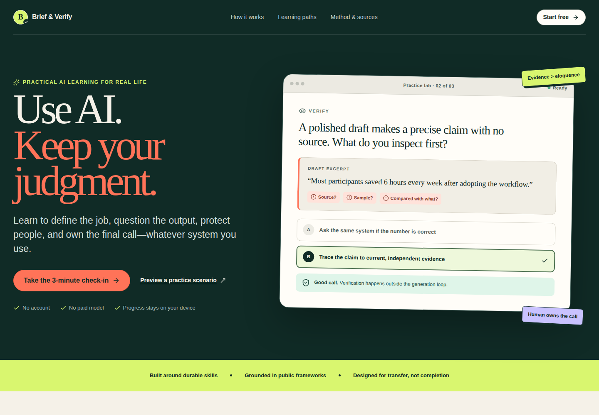

<p align="center">
  
</p>

<h1 align="center">Brief &amp; Verify</h1>

<p align="center"><strong>Free practice for making better decisions with AI.</strong></p>

<p align="center">
  Learn to explain a useful job, check important results, protect people and information,<br>
  and keep the final decision where it belongs: with a person.
</p>

<p align="center">
  <a href="https://edcadet10.github.io/brief-and-verify/"><strong>Open the live experience</strong></a>
  &nbsp;&nbsp;
  <a href="https://edcadet10.github.io/brief-and-verify/#/about">Read the method</a>
</p>

<p align="center">
  <a href="https://github.com/edcadet10/brief-and-verify/actions/workflows/ci.yml"></a>
  <a href="LICENSE"></a>
  <a href="CONTENT_LICENSE.md"></a>
</p>



Brief & Verify is an openly licensed learning project and reusable teaching kit for everyday users, care and health-service teams, educators, small-business owners, public servants, and community leaders. It works with any AI system; it is not a product tutorial or a certification.

| Explore the project | Build with the project |
| --- | --- |
| [Try it in 60 seconds](#try-it-in-60-seconds) | [Run it locally](#run-it-locally) |
| [See what is included](#what-is-included) | [Understand the architecture](#architecture-and-integration-boundaries) |
| [Review its evidence limits](#what-it-measures-and-what-it-does-not) | [Make a contribution](#contributing) |
| [Read the research basis](#research-basis) | [Report a security concern](SECURITY.md) |

## Try it in 60 seconds

1. Open the [live learning experience](https://edcadet10.github.io/brief-and-verify/). No account or paid service setup is required.
2. Select **Start free** (or **Continue** on a returning browser), choose a work context and experience level, then complete the six-decision check-in.
3. Open the suggested path and try a scenario for your kind of work. Every response and result is written in advance, so you can review it in this repository.
4. Visit **Progress** to review your exercise results or to save, restore, and reset the progress kept in your browser.

For a quick tour of every route, start with [the project method](https://edcadet10.github.io/brief-and-verify/#/about).

## What is included

| Part | What a learner can do |
| --- | --- |
| Six-question check-in | Find a useful starting point without being labeled or certified |
| Six learning modules | Practice AI basics, task choice, clear instructions, fact-checking, privacy, and responsible decisions |
| Six role-specific scenarios | Make three important choices and see immediate written feedback |
| Resource library | Search lessons, exercises, scenarios, and printable one-pagers |
| Lesson kit builder | Choose and combine lessons, then save a teaching guide or data file |
| Progress view | Keep understanding, practice choices, confidence, and a seven-day workplace test separate |
| Local data controls | Save, restore, or reset progress without creating an account |

The built-in lessons are repeatable: the same choice produces the same written feedback. The app can support other services later, but the public experience does not need one.

## Why static-first

The deployed application needs no login, paid API, database, tracking script, or runtime content service. Curriculum and feedback are versioned with the code, and progress remains in browser storage for the current site and device.

That makes the experience free to use, easy to inspect, and able to finish an already-loaded session without a runtime service. It also creates clear limits:

- progress does not sync automatically across browsers or devices;
- practice conversations follow authored branches rather than generating open-ended replies;
- local exercise performance is not proof of durable behavior change at work; and
- automated accessibility checks do not replace testing with people and assistive technology.

## What it measures and what it does not

The project keeps four evidence levels separate:

1. **Understanding** in a short lesson check.
2. **Choices in practice** in a written scenario.
3. **Your own report of workplace use** in a seven-day field test.
4. **Long-term behavior change**, which this application does not claim to measure.

Completion is recorded as progress, not presented as competence. See the [architecture note](docs/ARCHITECTURE.md#measurement-boundary) for the measurement boundary and the [research source map](src/data/sources.ts) for how each reference informed the curriculum.

## Run it locally

Prerequisites: Node.js 22.12 or newer and npm 10 or newer.

```bash
git clone https://github.com/edcadet10/brief-and-verify.git
cd brief-and-verify
npm ci
npm run dev
```

Vite prints the local URL. Production builds use the `/brief-and-verify/` base path so the same assets work on the project site.

### Useful commands

| Command | Purpose |
| --- | --- |
| `npm run dev` | Start the local development server |
| `npm run check` | Run linting, deterministic unit/component tests, TypeScript compilation, and a production build |
| `npm run test:e2e:install` | Install the Playwright-managed Chromium browser once |
| `npm run test:e2e` | Test the learner journey, authored scenario, mobile layout, landmarks, accessibility, and plain-language guardrails |
| `npm run preview` | Preview the production build locally |

Selected component tests include detectable accessibility rules in a simulated DOM. The end-to-end suite runs the broader accessibility audit—including color contrast—in a real browser.

Before the first browser test, run `npm run test:e2e:install`. On a fresh Debian or Ubuntu environment, use `npx playwright install --with-deps chromium` instead so Playwright can install required system libraries; that command may request administrator access.

## Architecture and integration boundaries

```text
Typed curriculum  ──>  React learning flows  ──>  browser state
        │                         │                       │
        └─ practice provider     ├─ storage adapter ─────┘
                                  └─ analytics adapter
```

The application uses React, TypeScript, Vite, and hash-based routing for reliable static hosting. Three deliberately small interfaces isolate future integrations:

- [`LearningAssistantProvider`](src/lib/providers/contracts.ts) starts an authored scenario, evaluates a choice, and advances a turn;
- [`StorageAdapter<T>`](src/lib/storage/contracts.ts) reads, writes, and clears learner state; and
- [`LearningAnalyticsAdapter`](src/lib/analytics/contracts.ts) records and lists learning events.

The built-in implementations are deterministic and local. A networked implementation would need explicit consent, data minimization, retention rules, failure handling, and an offline fallback. Read [the full architecture note](docs/ARCHITECTURE.md) before changing an adapter boundary.

Content is intentionally reviewable:

- `src/data/modules.ts` contains the lesson sequence and checks;
- `src/data/scenarios.ts` contains choices, consequences, and scoring;
- `src/data/resourceGuides.ts` contains the printable one-pagers; and
- `src/data/sources.ts` records the public sources and their stated use.

The deployed app makes no runtime request for a third-party font, model, analytics service, or curriculum source. Its research links are outbound links a learner can choose to open.

## Research basis

The competency map, safeguards, and delivery choices were informed by public primary and scholarly sources:

- [U.S. Department of Labor AI Literacy Framework](https://www.dol.gov/agencies/eta/advisories/ten-07-25)
- [OECD and European Commission: Empowering Learners for the Age of AI](https://doi.org/10.1787/65cd27d4-en)
- [NIST Generative AI Profile](https://doi.org/10.6028/NIST.AI.600-1)
- [UNESCO AI Competency Framework for Students](https://unesdoc.unesco.org/ark:/48223/pf0000391105)
- [Adaptive training instructional interventions: a meta-analysis](https://pmc.ncbi.nlm.nih.gov/articles/PMC12413037/)
- [Web Content Accessibility Guidelines 2.2](https://www.w3.org/TR/WCAG22/)

These sources inform learning objectives, evidence language, and safeguards; they do not endorse the project. Product wording, scenarios, exercises, and interface design are original. The in-app About page and [`src/data/sources.ts`](src/data/sources.ts) explain how each source was used.

## Contributing

Contributions to code, curriculum, research, accessibility, and documentation are welcome.

- Start with the [contribution guide](CONTRIBUTING.md), which includes setup, content standards, file pointers, and review criteria.
- Pick a scoped [`good first issue`](https://github.com/edcadet10/brief-and-verify/issues?q=is%3Aissue+is%3Aopen+label%3A%22good+first+issue%22) or use the [issue chooser](https://github.com/edcadet10/brief-and-verify/issues/new/choose).
- Use [Discussions](https://github.com/edcadet10/brief-and-verify/discussions) for questions, teaching adaptations, or an idea that is not ready to become an issue.
- Read the [Code of Conduct](CODE_OF_CONDUCT.md) before participating and the [governance note](GOVERNANCE.md) for how decisions are made.

A helpful first contribution is small enough to review in one sitting: clarify one explanation, improve one test, verify one source, or make one interaction more accessible. Open an issue before a large curriculum or architecture change.

## Accessibility, privacy, and security

The interface uses semantic controls, skip links, visible focus states, reduced-motion support, responsive layouts, and automated checks for detectable WCAG issues. Please report gaps; automated results are only one part of accessibility work.

Learning progress stays in your browser. Clearing site data removes it, and the **Progress** page lets you save, restore, or reset it. The web host may keep standard visit records; the app itself adds no cookies or tracking.

Do not enter real personal, health, student, customer, case, or confidential information into examples or reports. Report a vulnerability privately using the instructions in [SECURITY.md](SECURITY.md).

## License

Application code is available under the [MIT License](LICENSE). Original curriculum content is available under [CC BY 4.0](CONTENT_LICENSE.md), so educators can adapt and teach it with attribution.
